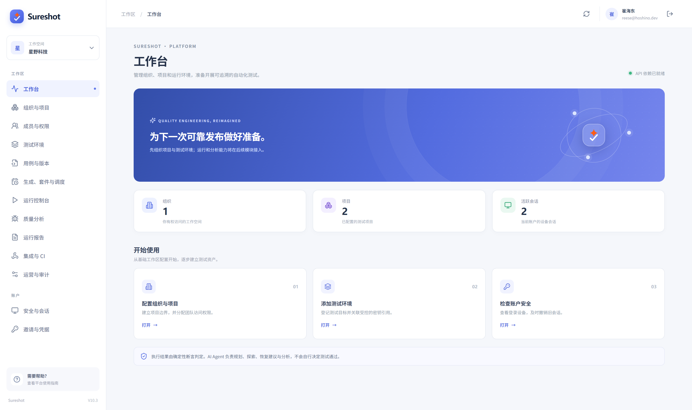
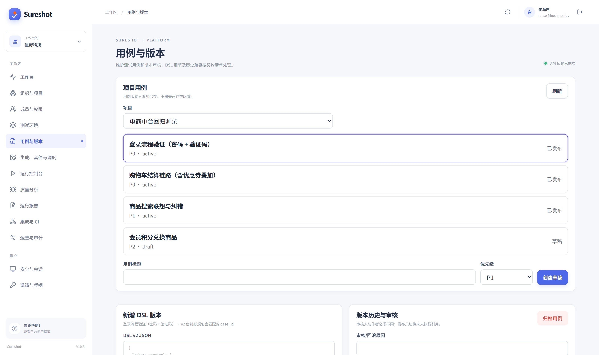
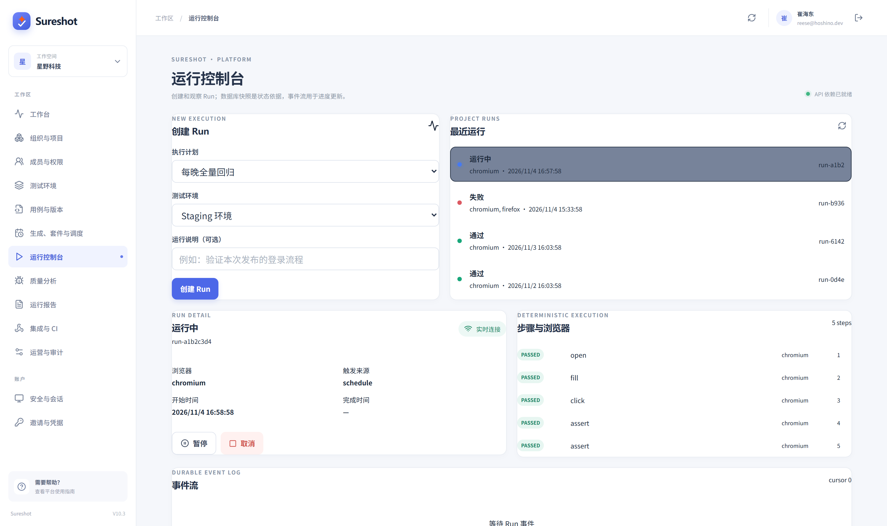
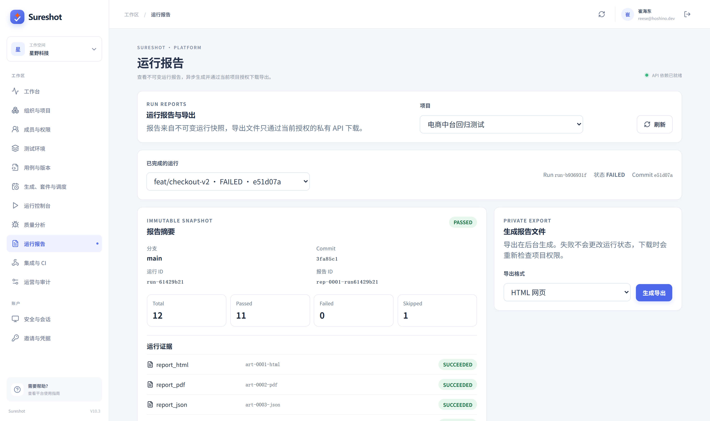
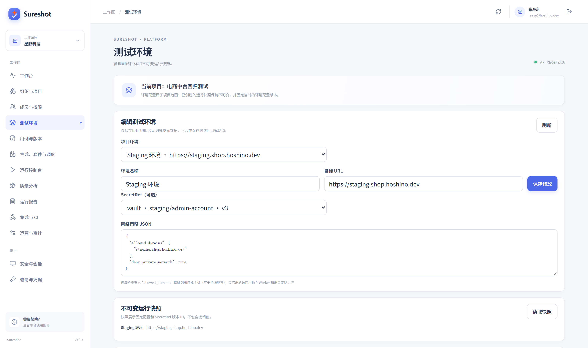
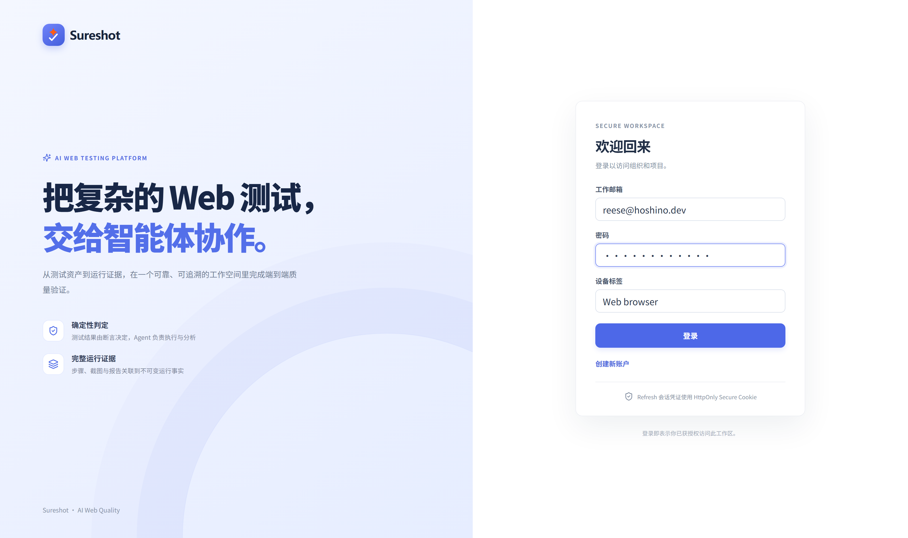
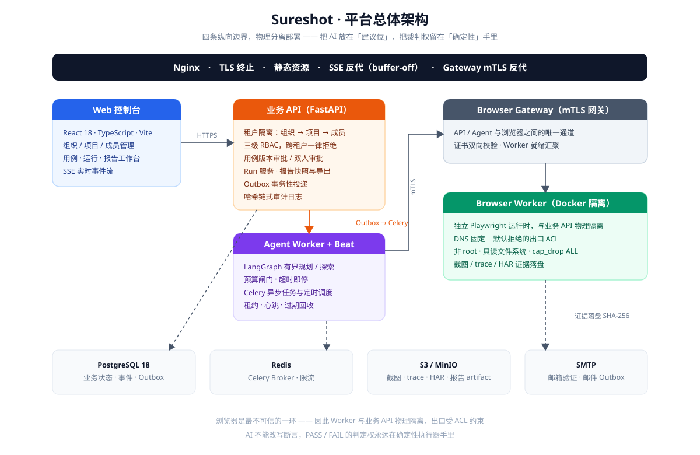
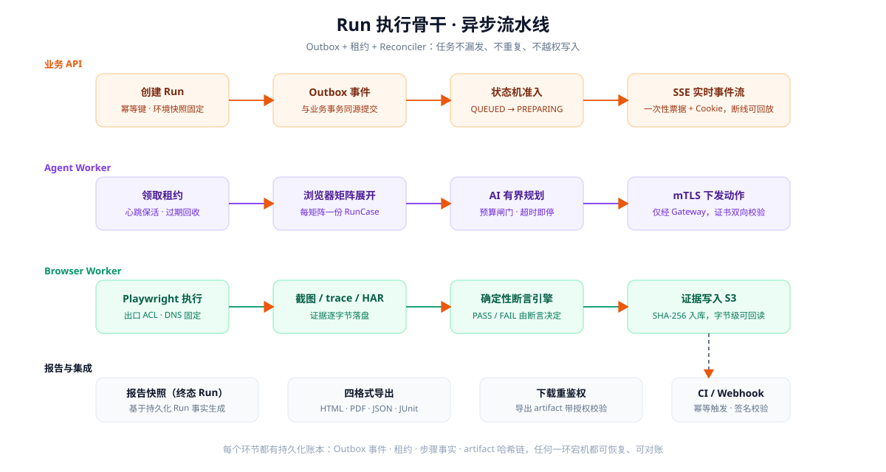
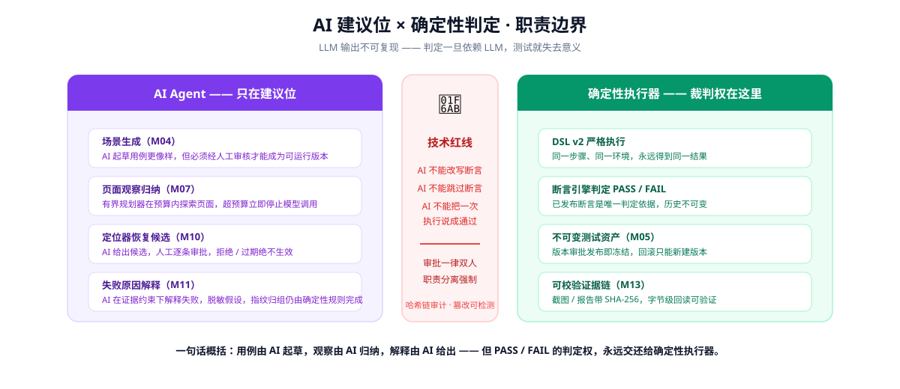

<div align="center">


**面向企业 Web 应用的 AI 辅助自动化测试平台**

[](https://www.python.org/)
[](https://fastapi.tiangolo.com/)
[](https://react.dev/)
[](https://www.typescriptlang.org/)
[](https://www.postgresql.org/)
[](https://playwright.dev/)

**[平台简介](#-平台简介) · [架构总览](#-架构) · [内置功能](#内置功能) · [获取方式与价格](#-获取方式与价格) · [商务联系](#-商务联系)**

</div>

---

## 🔒 授权声明

**本项目为闭源商业软件，当前仓库仅供受邀人员在线查阅。**

- ❌ **禁止** 下载、Clone、Fork、导出、截图转载本仓库任何源码与文档
- ❌ **禁止** 未授权复制、修改、二次分发、商业使用
- ✅ 仅允许受邀者通过仓库的在线预览权限查看功能与架构介绍
- 违反上述约定，作者保留追究法律责任的权利

---

## 🚫 严肃声明：AI 只建议，判定由确定性执行器决定

> 这不是一句装饰话，而是这个项目的技术红线。
>
> 用例由 AI 起草得更像样，页面观察由 AI 归纳得更清楚，失败原因由 AI 解释得更易懂 ——
> 但只要涉及 **PASS / FAIL 的判定权**，一律交还给确定性执行器和已发布的断言。
> AI 不能改写断言，不能跳过断言，也不能把一次执行说成通过。

---

## 🐶 环境要求

- **后端**：Python >= 3.11
- **前端**：Node.js >= 20.19.0，或 >= 22.13.0，或 >= 24
- **网关 / Worker**：Node.js >= 22 < 25，Worker 需要 Docker 与 Playwright 浏览器运行时
- **数据库 / 中间件**：PostgreSQL、Redis、SMTP、S3 兼容对象存储 —— 完整业务流程缺一不可

---

## 🐯 平台简介

**Sureshot**，以「让 AI 建议，让代码裁决」为设计取向的企业级自动化测试平台。

管理组织与项目、测试环境、测试用例与执行计划，并通过**隔离的浏览器 Worker** 运行 Web 自动化测试。具备如下特性：

- **租户隔离**：组织 → 项目 → 成员三级 RBAC，跨租户访问一律拒绝
- **不可变测试资产**：用例版本一旦审批发布即不可改，回滚只能新建版本，历史永远可追溯
- **双人审批**：用例版本审批、系统设置变更、视觉基线更新都强制职责分离
- **异步执行骨干**：Outbox + 租约 + Reconciler，任务不漏发、不重复、不越权写入
- **独立浏览器执行**：Worker 与业务 API 物理分离，走 mTLS 网关，出口受 ACL 约束
- **全程可审计**：哈希链式审计日志，篡改可检测
- **证据可校验**：报告四格式导出，artifact 落盘带 SHA-256，字节级可回读验证

### 📸 平台预览

| 工作台 | 用例与版本 |
| --- | --- |
|  |  |
| **运行控制台** | **运行报告** |
|  |  |
| **测试环境** | **登录页** |
|  |  |

> 更多页面：[生成、套件与调度](docs/images/screens/planning.png) · [组织与项目](docs/images/screens/projects.png) · [成员与权限](docs/images/screens/members.png)

---

## 🔥 架构

### 平台总体架构

四条纵向边界，刻意分开部署。浏览器是最不可信的一环（SSRF、DNS 重绑定、恶意页面），因此 Worker 与业务 API 物理隔离：

<div align="center"></div>

### Run 执行骨干

Outbox + 租约 + Reconciler：投递与业务事务同源，杜绝「事务提交了但任务丢了」或「任务发了但事务回滚了」两类事故：

<div align="center"></div>

### AI 建议位 × 确定性判定

为什么 AI 不碰判定？LLM 输出不可复现，判定一旦依赖 LLM，同一个用例两次运行可能给出不同结论，测试就失去意义：

<div align="center"></div>

---

## 技术栈

### 后端

| 框架 | 说明 | 版本 |
| --- | --- | --- |
| [Python](https://www.python.org/) | 运行时 | 3.11+ |
| [FastAPI](https://fastapi.tiangolo.com/) | Web 框架 | 0.115.0 |
| [SQLAlchemy](https://www.sqlalchemy.org/) | ORM | 2.0.35 |
| [Pydantic](https://docs.pydantic.dev/) | 数据校验 | 2.9.2 |
| [Celery](https://docs.celeryq.dev/) | 异步任务队列 | 5.6.3 |
| [LangGraph](https://langchain-ai.github.io/langgraph/) | 有界 Agent 编排 | 1.2.18 |
| [boto3](https://boto3.amazonaws.com/v1/documentation/api/latest/index.html) | S3 对象存储 | 1.43.123 |
| [reportlab](https://www.reportlab.com/) | PDF 报告渲染 | 4.4.10 |
| [PyJWT](https://pyjwt.readthedocs.io/) | 会话令牌 | 2.8.0 |

### 前端

| 框架 | 说明 | 版本 |
| --- | --- | --- |
| [React](https://react.dev/) | UI 框架 | 18.3.1 |
| [Vite](https://cn.vitejs.dev/) | 开发与构建工具 | 5.4.21 |
| [TypeScript](https://www.typescriptlang.org/) | JavaScript 超集 | 5.7.2 |
| [Vitest](https://vitest.dev/) | 单元测试 | 2.1.8 |
| [Playwright](https://playwright.dev/) | 端到端测试 | 1.64.1 |
| [ESLint](https://eslint.org/) | 代码检查 | 9.17.0 |

### 浏览器执行与基础设施

| 组件 | 说明 | 版本 |
| --- | --- | --- |
| [Playwright](https://playwright.dev/) | 浏览器自动化 | 1.56.0 |
| PostgreSQL | 业务状态、事件、Outbox | 18 |
| Redis | Celery Broker、限流 | — |
| S3 / MinIO | 截图、trace、HAR、报告 artifact | — |
| Nginx | TLS 终止、SSE 反代、Gateway mTLS | — |
| PM2 | api / agent-worker / agent-beat 三进程守护 | — |
| Docker | 独立 Worker 运行时 | — |

---

## 内置功能

按 M01–M15 十五个模块组织，开箱即用：

### 平台基础（M01–M03）

| 功能 | 描述 |
| --- | --- |
| 账号体系 | 注册、邮件验证、登录、刷新、登出、会话管理；刷新令牌重放检测（重放即撤销整个令牌族） |
| 组织与项目 | 组织、项目、成员三级 RBAC；邀请 → 接受 → 权限生效；成员移除即时失效访问权 |
| 测试环境 | 环境 CRUD、不可变环境快照、SecretRef 密钥元数据（密钥值永不出现在响应里）、经 mTLS 网关的健康检查 |

### 测试资产（M04–M06）

| 功能 | 描述 |
| --- | --- |
| AI 场景生成 | AI 起草测试场景，强制人工审核后才能成为可运行版本；失败自动重试与死信查看 |
| 用例版本 | 严格 DSL v2、不可变历史、版本 diff 对比、职责分离审批、发布与回滚 |
| 套件与计划 | 套件内用例排序、5 段式时区感知调度、启停/暂停/恢复、浏览器矩阵展开 |

### 执行骨干（M07–M09）

| 功能 | 描述 |
| --- | --- |
| 有界 Agent | LangGraph 规划 / 探索、预算闸门（超预算立即停止模型调用）、断点续跑 |
| Worker 集群 | mTLS 注册、心跳、就绪发现、最小负载分配、会话亲和、出口 ACL（DNS 固定 + 默认拒绝） |
| Run 管理 | 创建/查询/取消/暂停/恢复/重试，状态机终态约束；SSE 实时事件流（一次性票据 + Cookie） |
| 确定性执行器 | 严格 DSL 执行与断言引擎，PASS / FAIL 由已发布断言决定，租约 + 心跳 + 过期回收 |

### 恢复与质量分析（M10–M12）

| 功能 | 描述 |
| --- | --- |
| 定位器自愈 | AI 生成恢复候选，逐条强制人工审批，拒绝/过期绝不生效；恢复后重放单个失败动作并复核原始断言 |
| 失败分析 | 证据约束下的失败分析器、确定性指纹归组、缺陷分诊与哈希链审计 |
| 视觉基线 | 基线提案（精确上下文 + 职责分离）、遮罩式确定性像素 diff、质量工作台 |

### 报告与集成（M13–M15）

| 功能 | 描述 |
| --- | --- |
| 报告快照 | 基于持久化 Run 事实生成，不可篡改；HTML / PDF / JSON / JUnit 四格式导出，SHA-256 校验 |
| CI 集成 | 幂等 CI 触发（幂等键含环境与浏览器矩阵）、签名 Webhook 入站、出站投递重试与死信 |
| 运营 | 配额预留与结算、通知去重与偏好设置、用量统计、审计日志哈希链校验、系统设置双人审批 |

---

## 🚀 快速开始

### 启动 API

```bash
# 仓库根目录
python -m pip install -e "apps/api[test]"
python -m uvicorn apps.api.app.main:app --reload --host 127.0.0.1 --port 8000
```

启动后打开 `http://127.0.0.1:8000/docs` 查看 OpenAPI 文档。

### 启动 Web

```bash
npm --prefix apps/web ci
npm --prefix apps/web run dev
```

Vite 默认把 `/api` 转发到 `http://127.0.0.1:8000`，可用 `TESTPILOT_API_PROXY` 覆盖。

### 项目结构

```
Sureshot/
├── apps/
│   ├── web/                 React + TypeScript + Vite 单页应用
│   ├── api/                 FastAPI 业务 API、租户权限、持久化、Run 服务
│   ├── browser_gateway/     API/Agent 与浏览器 Worker 之间的 mTLS 网关
│   └── browser_worker/      独立 Playwright Worker（按会话约束出口）
├── db/migrations/           编号 PostgreSQL 迁移 001–018 + 只读检查工具
├── api/openapi.yaml         HTTP API 契约
├── contracts/               契约测试
├── deploy/                  PM2 / Nginx / ACL / 部署说明
└── docs/images/             架构图与功能截图
```

---

## 💰 获取方式与价格

本平台**不提供免费试用与开源版本**，仅通过以下方式交付：

| 方案 | 内容 | 价格 |
| --- | --- | --- |
| **源码交付** | 完整源码（Web / API / Gateway / Worker 四端）+ 数据库迁移 + 部署配置 + 文档 | **¥699** |
| **源码 + 部署服务** | 源码交付全部内容，另加：服务器环境部署、域名 / TLS 证书接入、系统联调、交付验收 | **¥996** |

> 交付前可按需演示线上功能；源码为一次性买断，含交付后的安装指导。
> 定制开发（新增模块、私有化改造、二次对接）另行报价。

---

## 📮 商务联系

- **微信**：`<请填写你的微信号>`
- **邮箱**：`<请填写你的商务邮箱>`
- **企业微信 / 其他渠道**：`<请填写>`

> 添加时请备注「**Sureshot 采购**」，说明需求方案（源码 / 源码+部署）与期望交付时间。
> 谢绝无效添加与白嫖咨询。

---

<p align="center">
  <sub>Sureshot · 让 AI 建议，让代码裁决</sub><br/>
  <sub>© 2026 Cui Haidong. 保留所有权利。未经授权禁止复制、下载与传播。</sub>
</p>
